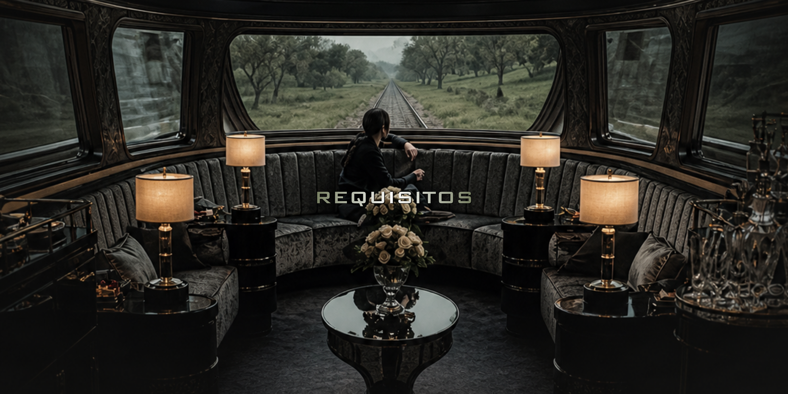

# REQUISITOS DO SISTEMA
### Ferrorama Mocking Rail

---

## 1. INTRODUÇÃO

Este documento apresenta os Requisitos Funcionais (RF), Requisitos Não Funcionais (RNF) e Regras de Negócio (RN) do Sistema de Monitoramento Ferroviário Inteligente Mocking Rail.

Os requisitos definem as funcionalidades, características técnicas e regras que orientam o desenvolvimento e a utilização do sistema, considerando as telas e os recursos previstos para o projeto.

O sistema tem como objetivo centralizar e facilitar o gerenciamento das informações relacionadas aos usuários, trens, sensores e rotas ferroviárias, além de apresentar indicadores gerais por meio do menu principal.

---

## 2. REQUISITOS FUNCIONAIS (RF)

Os Requisitos Funcionais descrevem as operações e funcionalidades que o sistema deve oferecer aos usuários.

| **REQUISITO FUNCIONAL** | **DESCRIÇÃO** |
| ----------------------- | ------------- |
| RF1 | O sistema deve permitir o login de usuários cadastrados, utilizando e-mail e senha. |
| RF2 | O sistema deve permitir o cadastro de usuários, incluindo nome, e-mail, telefone, senha e perfil de acesso. |
| RF3 | O sistema deve permitir a consulta e listagem dos usuários cadastrados. |
| RF4 | O sistema deve permitir a edição dos dados dos usuários. |
| RF5 | O sistema deve permitir a exclusão de usuários cadastrados. |
| RF6 | O sistema deve permitir o gerenciamento dos perfis de acesso, diferenciando Administradores e Usuários. |
| RF7 | O sistema deve permitir o cadastro de trens, incluindo nome, empresa, quantidade de vagões, tipo e responsável. |
| RF8 | O sistema deve permitir a consulta, edição e exclusão dos trens cadastrados. |
| RF9 | O sistema deve permitir o cadastro de sensores, incluindo nome, tipo, localização, trem associado, rota responsável e status. |
| RF10 | O sistema deve permitir a consulta, edição e exclusão dos sensores cadastrados. |
| RF11 | O sistema deve permitir o cadastro de rotas, incluindo nome, localização inicial e localização final. |
| RF12 | O sistema deve permitir a consulta, edição e exclusão das rotas cadastradas. |
| RF13 | O sistema deve permitir a pesquisa de registros nas telas de gerenciamento, facilitando a localização de usuários, trens, sensores e rotas. |
| RF14 | O sistema deve apresentar no menu principal indicadores gerais relacionados aos usuários, trens e sensores cadastrados. |
| RF15 | O sistema deve permitir a consulta dos detalhes do perfil do usuário autenticado, respeitando as permissões de acesso. |
| RF16 | O sistema deve permitir a consulta de endereços a partir do CEP informado no cadastro de rotas, quando o serviço externo estiver disponível. |

---

## 3. REQUISITOS NÃO FUNCIONAIS (RNF)

Os Requisitos Não Funcionais definem as características de qualidade, segurança, desempenho e funcionamento que o sistema deve atender.

| **REQUISITO NÃO FUNCIONAL** | **DESCRIÇÃO** |
| --------------------------- | ------------- |
| RNF1 – Segurança | O sistema deve armazenar as senhas dos usuários utilizando mecanismos seguros de hash. |
| RNF2 – Controle de acesso | O sistema deve restringir o acesso às funcionalidades administrativas de acordo com o perfil do usuário autenticado. |
| RNF3 – Integridade | O sistema deve validar os dados recebidos pelo backend antes de armazená-los no banco de dados. |
| RNF4 – Proteção de dados | O sistema deve utilizar consultas parametrizadas para proteger as operações realizadas no banco de dados. |
| RNF5 – Usabilidade | A interface deve apresentar formulários, tabelas, campos e mensagens organizados de maneira clara, facilitando a utilização do sistema. |
| RNF6 – Responsividade | O sistema deve adaptar sua interface para diferentes tamanhos de tela, incluindo computadores e dispositivos móveis. |
| RNF7 – Confiabilidade | O sistema deve apresentar mensagens adequadas quando ocorrerem falhas nas operações, evitando a exposição de informações técnicas ou sensíveis. |
| RNF8 – Manutenibilidade | O código deve ser organizado em arquivos e diretórios separados de acordo com suas responsabilidades, facilitando futuras alterações. |
| RNF9 – Desempenho | As consultas e operações de gerenciamento devem apresentar resultados em tempo adequado, sem comprometer a utilização das telas. |
| RNF10 – Disponibilidade dos dados | As informações cadastradas devem permanecer armazenadas no banco de dados após o encerramento da sessão. |

---

## 4. REGRAS DE NEGÓCIO (RN)

As Regras de Negócio estabelecem as condições e restrições que devem ser respeitadas durante a utilização do sistema.

| **REGRA DE NEGÓCIO** | **DESCRIÇÃO** |
| -------------------- | ------------- |
| RN1 | Cada usuário deve possuir um identificador único no sistema. |
| RN2 | O e-mail de cada usuário deve ser único, não sendo permitido cadastrar dois usuários com o mesmo endereço. |
| RN3 | Todo usuário deve possuir um perfil de acesso definido, podendo ser Administrador ou Usuário. |
| RN4 | Somente usuários autenticados podem acessar as áreas internas do sistema. |
| RN5 | As funcionalidades administrativas devem ser restritas aos usuários com perfil de Administrador. |
| RN6 | A criação de novos usuários com perfil de Administrador deve ser protegida, impedindo que usuários comuns atribuam privilégios administrativos a si mesmos. |
| RN7 | Cada trem deve possuir um identificador único e informações de cadastro válidas. |
| RN8 | A quantidade de vagões cadastrada para um trem deve ser um número inteiro maior que zero. |
| RN9 | Cada sensor deve possuir um identificador único para permitir sua identificação e gerenciamento. |
| RN10 | Todo sensor deve possuir um tipo definido, como velocidade, localização, consumo de energia, temperatura. |
| RN11 | Os sensores podem ser associados a trens e rotas cadastrados no sistema, respeitando os relacionamentos definidos no banco de dados. |
| RN12 | Todo sensor deve possuir um status definido, podendo estar Ativo ou Inativo. |
| RN13 | Cada rota deve possuir um identificador único, um nome e informações referentes à localização inicial e final. |
| RN14 | Os campos obrigatórios dos formulários devem ser preenchidos antes da realização de um cadastro ou alteração. |
| RN15 | Os dados informados devem respeitar os formatos e limites definidos para cada campo. |
| RN16 | As operações de edição e exclusão devem ser realizadas somente quando o registro informado existir no banco de dados. |
| RN17 | Os indicadores apresentados no menu devem ser calculados com base nos registros armazenados no banco de dados. |

---

## 5. RELAÇÃO ENTRE OS REQUISITOS E AS TELAS

Os requisitos estão relacionados às funcionalidades presentes na aplicação, conforme a organização atual das telas.

| **TELA** | **FUNCIONALIDADES RELACIONADAS** |
| -------- | -------------------------------- |
| Login | Autenticação e controle de acesso dos usuários. |
| Menu | Apresentação de indicadores gerais de usuários, trens e sensores. |
| Usuários | Cadastro, consulta, edição, exclusão e gerenciamento de perfis. |
| Trens | Cadastro, consulta, edição e exclusão de trens. |
| Sensores | Cadastro, consulta, edição e exclusão de sensores. |
| Rotas | Cadastro, consulta, edição e exclusão de rotas, incluindo informações de localização. |

---

## 6. CONSIDERAÇÕES FINAIS

Os requisitos apresentados estabelecem as funcionalidades e condições necessárias para o desenvolvimento do Mocking Rail.

Os Requisitos Funcionais descrevem as operações disponíveis nas telas, enquanto os Requisitos Não Funcionais definem critérios relacionados à segurança, usabilidade, desempenho e confiabilidade. As Regras de Negócio determinam as condições que devem ser respeitadas durante o gerenciamento das informações.